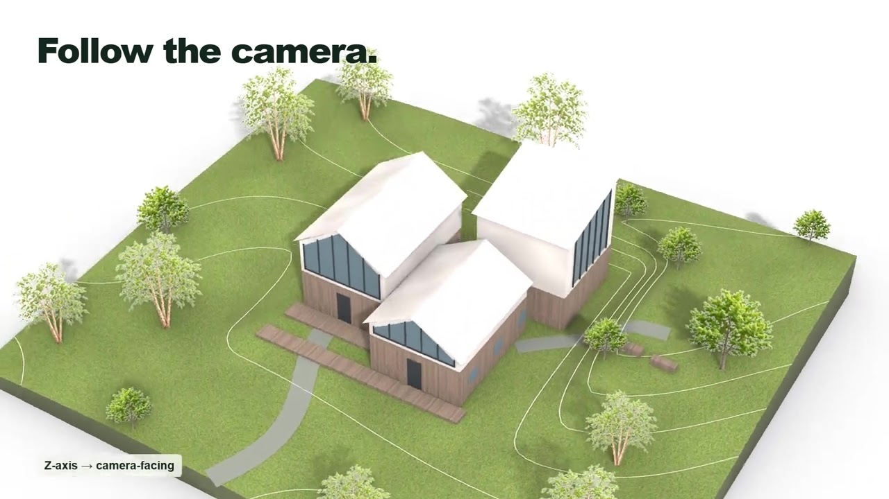
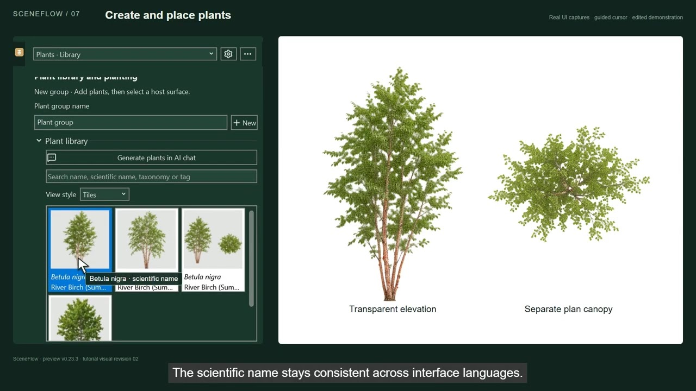

# SceneFlow for Rhino 8

**Public preview · 0.23.3 · Windows x64 · Rhino 8.34+ / .NET 8**

AI assets → physical-scale materials and UV → planting → layered PSD → AI postproduction.

[Download the preview](https://github.com/baoying-liu/RhinoSceneFlow/releases/tag/v0.23.3) · [Installation guide](docs/Getting-Started.md) · [Report an issue](https://github.com/baoying-liu/RhinoSceneFlow/issues)

## Videos

| Feature introduction | Tutorial 1: installation to 4K rendering |
| --- | --- |
| [](https://youtu.be/jZdimsuU_Iw) | [](https://youtu.be/-htcKoRhU-o) |
| **[Watch on YouTube](https://youtu.be/jZdimsuU_Iw)** · 4 min<br>AI materials, planting, layered PSD and AI rendering. | **[Watch on YouTube](https://youtu.be/-htcKoRhU-o)** · 15 min<br>English narration, captions and chapters. |

Click a preview to watch, or browse the [RhinoSceneFlow playlist](https://www.youtube.com/playlist?list=PLdXJS4Sb8Mno).

## Features

- **AI assets:** text/image references, existing-asset reuse, local shared libraries,
  categories and tags. The interface supports English and Chinese.
- **Materials and UV:** physical-scale checks before application, independent UV
  preparation and xatlas-based complex mesh unwrapping.
- **Planting:** mixed-species groups, density, random seeds, surface attachment,
  seasonal variants and camera-dependent elevation/plan display.
- **PSD export:** Named Views, resolution, material textures/colors, shadows,
  plants, Arctic display mode and depth channels.
- **Web studio:** PSD import, list/canvas views, traceable child images,
  annotations, references, PhotoCraft editing reference layers and HD processing.

## Installation

Run **`RhinoSceneFlow`** in Rhino to open the dockable tools.

Download the **EXE from Releases**, rather than GitHub's source ZIP, for installation.
The installer targets standard Rhino 8 for the current Windows user; it does not install
into RhinoDevSandbox B. Python/image runtimes and original McNeel MCP are bundled.
AI requires a separately installed Codex CLI, your own supported sign-in and image access.

This is an **unsigned public preview**, not a stable production release. Clean-machine
installation, repair, uninstall, cross-version upgrade and new-recipient authorization
remain unverified. Automatic update installation is disabled. Back up user work and
read the [installation guide and limitations](docs/Getting-Started.md).

## Documentation

- [Installation and first workflow](docs/Getting-Started.md)
- [Workspace](docs/Workspace.md) · [Materials and UV](docs/Materials.md)
- [Plant groups](docs/PlantGroups.md) · [PSD workbench](docs/Workbench.md)
- [Studio workflow](docs/Studio.md) · [MCP automation API](docs/MCP.md)
- [Installer architecture and remaining acceptance gates](docs/Release-Installer.md)
- [Third-party notices and licensing status](THIRD-PARTY-NOTICES.md) · [Security/privacy](SECURITY.md)
- [Development validation evidence](docs/Validation.md) · [Historical README](docs/README-History.md)

SceneFlow's original code is licensed under [MIT](LICENSE). Third-party components
retain their explicit licenses and notices. SceneFlow is independent of McNeel,
OpenAI, Microsoft and the PhotoCraft authors.

## Code signing policy

The published preview remains unsigned. An application for free foundation signing
has been submitted; no sponsorship or approval has been granted. See the [signing policy and application
readiness](docs/Code-Signing-Policy.md) and [privacy policy](docs/Privacy.md).

## Build

Requires .NET 8+ SDK, Rhino 8.34+, Node.js with the locked Web dependencies installed,
and the Windows C++ build tools for native workers / the installer. Use:

```powershell
cd web/postproduction
npm ci
cd ../..
./scripts/Build.ps1
./scripts/Build-Installer.ps1
./scripts/Test-Installer.ps1 -Version 0.23.2
```

The installer staging script fetches the hash-pinned embedded Python and pip
inputs when absent. Building the pyvips wrapper needs a development Python
interpreter; pass `-BuildPython <python.exe>` to Build-Installer.ps1 if the local
SceneFlow development venv is absent. See [Release-Installer.md](docs/Release-Installer.md).
The manually dispatched candidate-build workflow uses hash-pinned official Rhino
SDK references; it does not install Rhino, sign files or publish releases.
These are build artifacts, not user authentication or personal libraries.
A normal code build does not install into or restart a running Rhino session.
